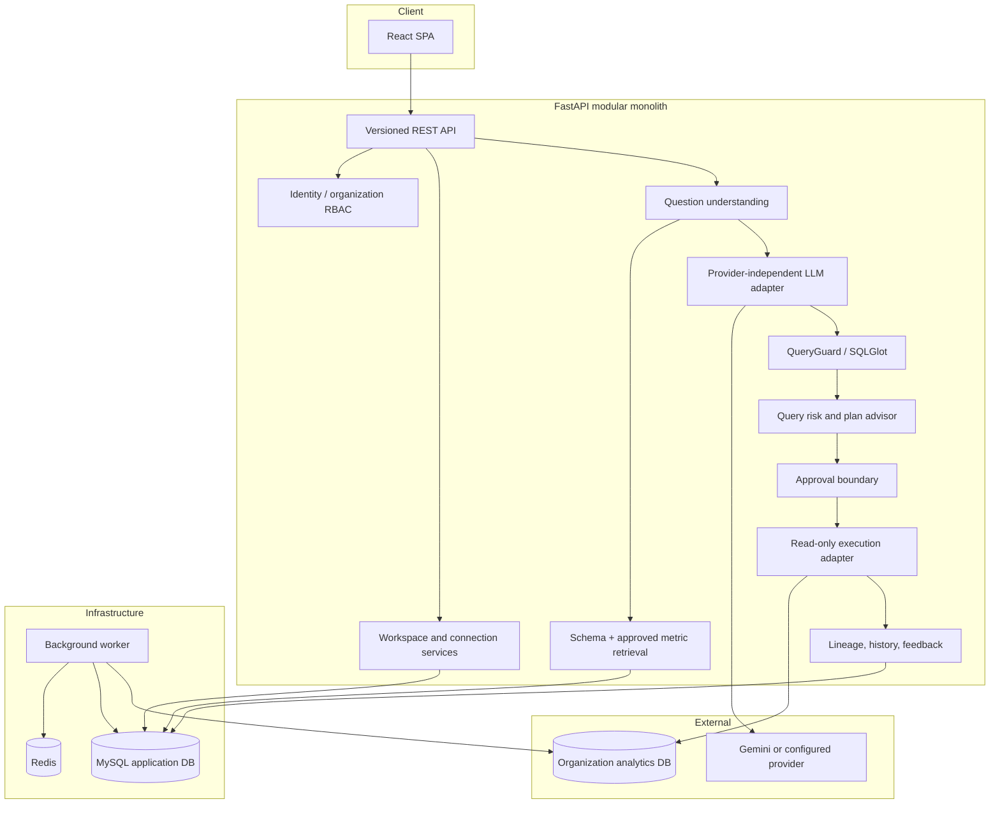

# Architecture Diagram

**Critical invariant:** no path from the LLM/provider directly to the analytics database exists. Only the read-only executor can open an analytics connection, and it accepts SQL that was validated and approved.
