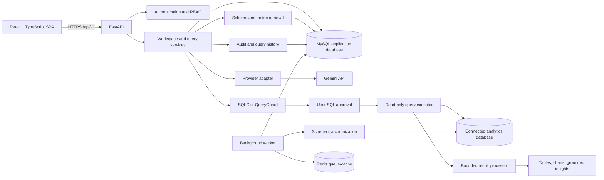

# QueryGenius System Design

## Product scope

QueryGenius turns a user's business question into a schema-aware, explainable SQL proposal, validates the exact SQL with a deterministic AST-based policy, and runs it through a separately configured read-only analytics connection. Users must approve the validated SQL before execution. Insights and visualizations are derived only from returned rows.

The initial architecture is a modular monolith. API, domain services, and workers share Python packages and one application database; query execution uses a separate connection pool and database identity. This keeps deployment simple while enforcing credential and tenant boundaries.

## Target architecture

## Trust boundaries

- The browser is an untrusted client; every resource lookup is authorized against its organization and workspace.
- User questions, LLM responses, schema descriptions, and saved SQL are untrusted input.
- The LLM can propose SQL but cannot approve, validate, or execute it.
- QueryGuard parses and checks the exact SQL shown for approval. Any edit requires validation again.
- The application database stores tenant-owned metadata and encrypted connector secrets. It is not the analytics database.
- Analytics connections use dedicated read-only credentials, per-connection allowlists, bounded results, and execution deadlines.
- Provider keys and encryption keys are deployment secrets and must never be returned by APIs or written to logs.

## Main request flow

1. Authenticate the user and resolve active organization/workspace membership.
2. Load an authorized database connection and retrieve only relevant indexed schema and approved metrics.
3. Extract intent, entities, filters, time ranges, output shape, and ambiguity.
4. Ask for clarification instead of guessing when a metric or required filter is ambiguous.
5. Ask a provider adapter for a structured SQL proposal using versioned prompts.
6. Validate the response schema, then run QueryGuard against the selected dialect, schema, tables, columns, functions, row cap, and execution policy.
7. Return SQL, explanation, lineage, assumptions, and risk information for explicit approval.
8. Revalidate edited SQL, execute read-only, enforce timeout/row/byte limits, and record an audit event.
9. Render actual rows; derive chart recommendations and bounded summaries from returned data.

## Data ownership

Every tenant-owned row carries an `organization_id`, directly or through an immutable parent relation. Repository methods require an organization scope; API tests prove cross-organization reads and writes are denied. Connector secrets are encrypted using a key supplied outside the database. Query results are not retained by default; execution metadata and bounded lineage are retained according to a configurable policy.

## Delivery and migration

The current root-level Flask application is a demo-era implementation. Phase 1 establishes the supported `frontend/` and `backend/` applications without deleting or silently migrating the legacy demo. Production data changes use Alembic migrations. The current user's MySQL choice is recorded in ADR-0001; analytics adapters and credential encryption are separate release gates.
